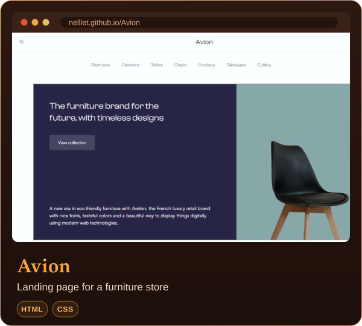
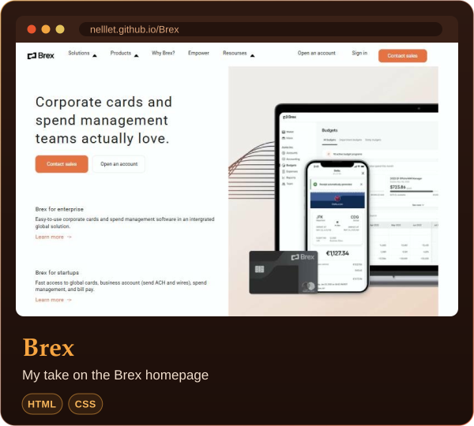

  

## About me

I'm Vlad, I'm 18 and I live in Zurich. Right now I'm in the first year of my apprenticeship as an IT Application Developer at Swisscom.

I mostly build things for the web with HTML, CSS and JavaScript, and I also write Python. To keep practicing, I solve Codewars katas in JavaScript.

## Tech stack

  
  
  
  
  

## Projects

<table>
  <tr>
    <td width="50%" align="center" valign="top">
      
       
      
      
    </td>
    <td width="50%" align="center" valign="top">
      
       
      
      
    </td>
  </tr>
  <tr>
    <td colspan="2" align="center">
      
       
      
    </td>
  </tr>
</table>

  

